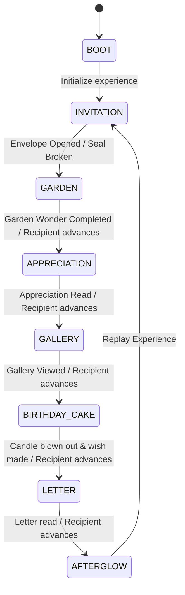

# Technical Architecture: Gheli — The Art of Being You

## 1. Architectural Philosophy

The architecture unifies the strengths of **Casa-Tanvi** (deterministic state machine, modular architecture, luxury typography, audio management) with the emotional and visual strengths of **Bhadwikabday** (animated SVG cake, Web Audio puff & chime synthesizer, blooming botanical garden, celebratory confetti), completely eliminating fragile iframe postMessage barriers and obsolete dependencies (jQuery).

---

## 2. Directory Organization

```
/ (Workspace Root: c:\Users\ADMIN\Desktop\Ghelikabday)
├── app/
│   ├── layout.tsx              # Root HTML wrapper, metadata, viewport, Google fonts
│   ├── page.tsx                # Mount point for ExperienceOrchestrator
│   └── globals.css             # Design tokens, color system, keyframe animations
├── components/
│   ├── experience/
│   │   ├── ExperienceOrchestrator.tsx  # Master state-driven scene switch
│   │   ├── ExperienceShell.tsx         # HUD, letterbox, ambient grain, noise overlays
│   │   ├── ProgressIndicator.tsx       # Subtle scene progression counter & dots
│   │   └── AudioController.tsx         # Floating sound toggle & audio context manager
│   ├── scenes/
│   │   ├── InvitationScene.tsx         # Scene 1: Envelope unboxing & seal interaction
│   │   ├── GardenScene.tsx             # Scene 2: Blooming botanical garden & butterflies
│   │   ├── AppreciationScene.tsx       # Scene 3: Celebrating Shruti's individuality & ambition
│   │   ├── GalleryScene.tsx            # Scene 4: Polaroid photo gallery & fullscreen lightbox
│   │   ├── BirthdayCakeScene.tsx       # Scene 5: Interactive cake, candle, smoke, balloons
│   │   ├── BirthdayLetterScene.tsx     # Scene 6: Unfolded handwritten parchment note
│   │   └── AfterglowScene.tsx          # Scene 7: Deep night sky, stardust, blessings & replay
│   ├── animations/
│   │   ├── Starfield.tsx               # 60 FPS Canvas2D ambient cosmic dust & twinkling stars
│   │   ├── FlowerGarden.tsx            # Multi-tiered botanical bloom simulation
│   │   ├── ButterflySystem.tsx         # Floating fluttering butterflies
│   │   ├── CandleSmoke.tsx             # Rising smoke particles on candle extinguish
│   │   └── CakeCelebration.tsx         # Interactive balloons, popping particles, confetti
│   ├── gallery/
│   │   ├── PhotoGallery.tsx            # Responsive Polaroid grid & deck view
│   │   ├── PhotoViewer.tsx             # Fullscreen lightbox with keyboard & swipe navigation
│   │   └── PolaroidCard.tsx            # Styled photo card with tape & handwriting
│   └── ui/
│       ├── Envelope.tsx                # 3D interactive envelope fold & seal
│       └── SoundToggle.tsx             # Animated speaker icon with wave indicator
├── content/
│   ├── birthday.ts                     # Core project constants & birthday recipient profile
│   ├── appreciation.ts                 # Scene 3 cards & celebratory quotes
│   ├── birthday-letter.ts              # Scene 6 heartfelt letter paragraphs
│   └── gallery.ts                      # Scene 4 photo items & captions
├── lib/
│   ├── audio/
│   │   └── audio-synthesizer.ts        # Zero-asset Web Audio synth (puff, chimes, pops, chords)
│   └── animation/
│       └── gsap-helpers.ts             # Safe GSAP timeline helpers & cleanup utilities
├── state/
│   └── experience-store.ts             # Zustand-powered deterministic scene state machine
├── docs/                               # Complete project documentation & audit logs
└── public/
    └── textures/                       # Ambient paper grain textures
```

---

## 3. Scene State Machine



Every scene transition satisfies:
1. **User Control**: No sudden auto-advancing timers. Shruti decides when to continue.
2. **Deterministic Validation**: Transitions check valid edges before moving state.
3. **Clean Teardown**: Timers, requestAnimationFrame loops, and AudioContext nodes are canceled on unmount.
4. **Development Jump**: Local development allows immediate jump via URL query (e.g. `?scene=BIRTHDAY_CAKE`).
